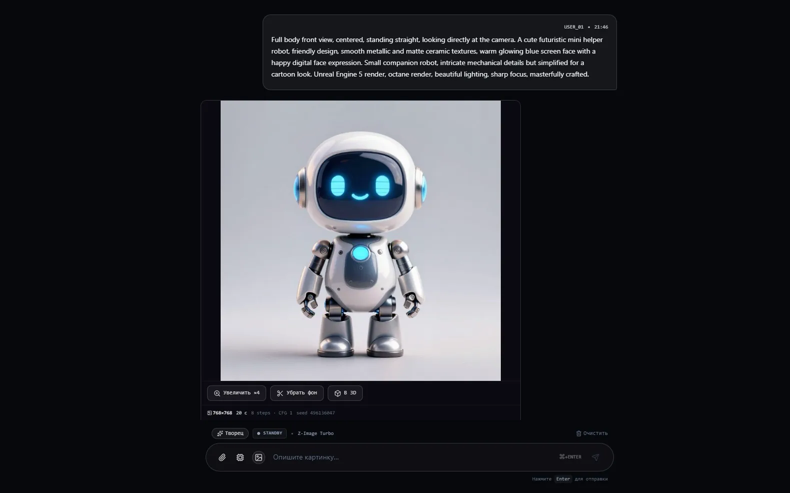

# HC AI 3D

Локальный мультимодальный ассистент для Windows: **чат, генерация картинок, зрение,
апскейл, удаление фона и image-to-3D** - всё считается на вашей машине. Без облака,
без API-ключей, без подписок.

`Electron 30` + `React 19` + `node-llama-cpp` + `stable-diffusion.cpp (Vulkan)` +
`llama.cpp (Vulkan)` + `ComfyUI (sidecar)`

Проект самодостаточен: `npm run download:all` кладёт всё нужное внутрь приложения, и
без единой переменной окружения он работает. Если веса уже лежат в общем каталоге на
диске, приложение подхватит их оттуда - см. [«Модели: где лежат»](#модели-где-лежат).



## Требования

|  |  |
| --- | --- |
| ОС | Windows 10/11 x64 |
| Node.js | 20 или новее |
| GPU | с поддержкой Vulkan (NVIDIA / AMD / Intel Arc) |
| VRAM | 8 ГБ: на карте живёт одна тяжёлая модель за раз |
| RAM | 16 ГБ рекомендуется - используется как кэш моделей |
| Диск | ~15 ГБ под чат, картинки, зрение и сборку; **~42 ГБ**, если нужен ещё фон и 3D |
| ComfyUI | портативная сборка `ComfyUI-Easy-Install` (~14 ГБ) - только для фона и 3D |

Цифра «13 ГБ» в интернете и на карточках - это **базовый** набор: чат, генерация
картинок, зрение, апскейл. 3D в него не входит: там отдельно ~13 ГБ весов и ~14 ГБ
сама сборка ComfyUI, то есть до ~42 ГБ на диске.

## Быстрый старт

```bash
git clone https://github.com/CityStas/hc_local_ai_image_3D
cd hc_local_ai_image_3D
npm install
npm run download:all      # ~13 ГБ: чат, картинки, зрение, апскейл
npm start
```

`npm start` собирает фронтенд и поднимает Electron. Модель грузится лениво - при
первом сообщении, прогресс виден в интерфейсе.

## Модели: скачать

Наборы - от минимального к полному. Всё, что уже лежит на диске, скрипты пропускают;
обрыв связи переживают докачкой с того же байта.

| что нужно | команда | размер |
| --- | --- | --- |
| только чат | `npm run download:llm` | 0.5 ГБ |
| **картинки + зрение**, без чата и 3D | `npm run download:image-vision` | ~12.6 ГБ |
| **всё базовое** (чат, картинки, зрение, апскейл) | `npm run download:all` | ~13 ГБ |
| **только 3D** (нужна сборка ComfyUI) | `npm run download:3d` | ~13 ГБ |
| всё, включая 3D и оба бэкбона | `npm run download:everything` | ~42 ГБ |

3D полностью необязателен: без ComfyUI приложение работает, а «Убрать фон» и «В 3D»
скажут, чего не хватает. Для чата, картинок и зрения хватает `download:all`.

По шагам:

| команда | размер | что даёт |
| --- | --- | --- |
| `npm run download:llm` | 507 МБ | Qwen3.5 0.8B - чат и служебная логика |
| `npm run download:zimage` | 6.5 ГБ | Z-Image Turbo: диффузия + VAE + текстовый энкодер |
| `npm run download:vlm-model` | 5.5 ГБ | Qwen2.5-VL 7B + mmproj - зрение |
| `npm run download:vulkan` | 37 МБ | `sd-cli` / `sd-server` (Vulkan) |
| `npm run download:vlm` | 97 МБ | `llama-server` / `llama-mtmd-cli` (Vulkan) |
| `npm run download:esrgan` | 45 МБ | Real-ESRGAN ncnn - апскейл ×4 |
| `npm run download:moondream` | 3.7 ГБ | альтернативная модель зрения |
| `npm run download:3d` | 13 ГБ | 10 файлов для фона и image-to-3D в `ComfyUI\models\**` |
| `npm run download:3d-all` | 19.8 ГБ | то же + бэкбон Trellis2 (альтернатива Pixal3D) |

Скрипты кладут файлы туда, где их ищут движки, докачивают с места обрыва
(`Range` + `.part`) и не перекачивают готовое. `download:3d` дополнительно сверяет
`sha256` каждого файла - недокачанный или перезалитый на HF файл не сойдёт за рабочий.

Источники: [unsloth/Qwen3.5-0.8B-GGUF](https://huggingface.co/unsloth/Qwen3.5-0.8B-GGUF),
[leejet/Z-Image-Turbo-GGUF](https://huggingface.co/leejet/Z-Image-Turbo-GGUF),
[Tongyi-MAI/Z-Image-Turbo](https://huggingface.co/Tongyi-MAI/Z-Image-Turbo) (VAE),
[unsloth/Qwen3-4B-Instruct-2507-GGUF](https://huggingface.co/unsloth/Qwen3-4B-Instruct-2507-GGUF),
[ggml-org/Qwen2.5-VL-7B-Instruct-GGUF](https://huggingface.co/ggml-org/Qwen2.5-VL-7B-Instruct-GGUF),
[ggml-org/moondream2-20250414-GGUF](https://huggingface.co/ggml-org/moondream2-20250414-GGUF),
[Comfy-Org/Pixal3D](https://huggingface.co/Comfy-Org/Pixal3D),
[Comfy-Org/MoGe](https://huggingface.co/Comfy-Org/MoGe),
[Comfy-Org/BiRefNet](https://huggingface.co/Comfy-Org/BiRefNet),
[VAST-AI/TripoSplat](https://huggingface.co/VAST-AI/TripoSplat),
[Comfy-Org/TRELLIS.2](https://huggingface.co/Comfy-Org/TRELLIS.2),
[leejet/stable-diffusion.cpp](https://github.com/leejet/stable-diffusion.cpp/releases) (`master-829-0a565f2`),
[ggml-org/llama.cpp](https://github.com/ggml-org/llama.cpp/releases) (`b10679`),
[xinntao/Real-ESRGAN](https://github.com/xinntao/Real-ESRGAN/releases/tag/v0.2.5.0).

### Фон и 3D - отдельным шагом

Нужна портативная сборка `ComfyUI-Easy-Install` (внутри `python_embeded\python.exe` и
`ComfyUI\main.py`), в репозиторий она не входит. Со `python_embeded` и `torch` это
~14 ГБ - их не качает ни один `npm run download:*`.

1. положить сборку в `comfy/ComfyUI-Easy-Install/` рядом с приложением **или**
   указать путь: `set HC_COMFY_ROOT=D:\ComfyUI-Easy-Install`;
2. `npm run download:3d` - раскладывает 10 файлов прямо в `ComfyUI\models\**`
   (13 ГБ). `npm run download:3d-all` добавляет бэкбон Trellis2 (+6.5 ГБ);
3. доставить ноды из `workflows/comfy/` (GGUF-загрузчик UNet, birefnet, Trellis2,
   TripoSplat, MoGe, Pixal3D) - ComfyUI сам перечислит отсутствующие при первом запуске.

Раскладка внутри `ComfyUI\models\`: `diffusion_models\` (pixal3d, triposplat,
trellis_2), `clip_vision\` (dino_v3), `vae\` (trellis_2, flux2, triposplat_vae_decoder),
`geometry_estimation\` (moge_2), `background_removal\` (birefnet).

Если эти же веса уже лежат в общем каталоге (например, их положил другой локальный
инструмент), качать второй раз не нужно - достаточно `HC_COMFY_ROOT` и `HC_MODELS_ROOT`
на этот каталог.

## Модели: где лежат

Абсолютных путей в коде нет - буква диска не зашита нигде. **По умолчанию всё, что
качает `npm run download:*`, лежит внутри приложения** - ничего настраивать не нужно,
внешние каталоги это только опция.

| переменная | по умолчанию | что задаёт |
| --- | --- | --- |
| `LOCAL_LLM_MODELS` | пусто | **общий** корень весов на машине; нейтральное имя, его может читать любой локальный инструмент |
| `HC_MODELS_ROOT` | `LOCAL_LLM_MODELS`, иначе ресурсы приложения | корень весов только для HC AI (побеждает общий) |
| `HC_COMFY_ROOT` | `<models>/text_image_3D/3d_gen/3d_comfy/ComfyUI-Easy-Install`, иначе `comfy/` рядом с приложением | сборка ComfyUI |
| `HC_BIN_ROOT` | папка приложения | где искать `sd-server`, `llama-server` |

Общий каталог нужен, только если веса уже лежат где-то на диске и качать их второй раз
незачем. Тогда путь задаётся один раз на машину:

```cmd
setx LOCAL_LLM_MODELS "D:\AI\Models"
```

Если общий корень нужен только этому приложению, путь пишется в `.env` рядом с
`package.json` (файл в git не попадает, образец - `.env.example`):

```cmd
copy .env.example .env
:: затем в .env:
LOCAL_LLM_MODELS=D:\AI\Models
```

Раскладка внутри корня: `image/z-image-turbo/`, `vlm/Qwen2.5-VL-7B/`, `llm/`,
`text_image_3D/` (ComfyUI и его модели), `bin/` (sd-server, llama-server).

Порядок поиска: ресурсы приложения (`node_modules/electron/dist/resources/`, из неё же
`electron-builder` пакует `.exe`) → папки рядом с приложением → внешний корень.
Свои файлы главнее, внешний корень подхватывается, только если своих нет.

## Что умеет

- **Чат** - стриминг, история, несколько сессий, персоны. Qwen3.5 0.8B крутится прямо
  в главном процессе Electron через `node-llama-cpp`. Свои GGUF подключаются
  инспектором: архитектура, квант, слои, контекст читаются из заголовка файла.
- **Картинки** - Z-Image Turbo (768×768, euler + `sgm_uniform`, distilled guidance 3.5)
  через `sd-server` на Vulkan. Промпт на русском переводится встроенной LLM. EDIT-режим
  решает, доработать картинку или нарисовать новую; композитинг «продукт → сцена»
  накладывает объект поверх сгенерированного фона пиксельно, с тенью и альфой.
- **Зрение** - Qwen2.5-VL 7B + `mmproj Q8_0`; чипы «Описать», «OCR», «Объекты»,
  «Калории». На 8 ГБ VRAM mmproj уходит на CPU.
- **Апскейл** - Real-ESRGAN ncnn Vulkan ×4 (`realesrgan-x4plus`, `-anime`,
  `realesr-animevideov3`, `realesr-general-x4v3`).
- **Фон и 3D** - ComfyUI-сайдкар на `127.0.0.1:8188`: `birefnet` → PNG с альфой;
  image-to-3D двумя воркфлоу (**Trellis2** - детальнее, **TripoSplat** - быстрее) и
  встроенный просмотрщик GLB. Имя файла берётся из промпта картинки.
- **Галерея вариантов** - под каждой картинкой `Оригинал` / `Без фона` / `×4` / `3D`;
  клик делает вариант активным для остальных инструментов.
- **Арбитраж RAM/VRAM** - тяжёлые соседи гасятся по очереди (`sd-server` ~6.5 ГБ,
  VLM ~5.5 ГБ, ComfyUI), лёгкая LLM ~0.7 ГБ остаётся в VRAM. ComfyUI не переживает
  сессию: pid-файл, авто-стоп по простою, гашение перед каждой генерацией.
- **Префетч** GGUF в page-cache RAM (`prefetch.cjs`) - повторная загрузка идёт из
  памяти; замеры в [`BENCHMARKS.md`](BENCHMARKS.md).
- Полностью офлайн: ни телеметрии, ни аналитики, ни сетевых вызовов.

## Как проверить, что всё встало

```bash
npm start
```

1. В шапке `HC AI`, справа модель `Qwen3.5 0.8B`. Спросите что-нибудь - пойдёт
   стриминг, в HUD появятся tok/s. Нет модели - в ответе будет подсказка про
   `npm run download:llm`.
2. Режим картинок, «кот в шлеме астронавта» - 15-25 с на `sd-server`.
3. Приложите фото, чип **Описать** / **OCR** - включится Vision.
4. **Увеличить ×4** - апскейл.
5. **Убрать фон** - ComfyUI поднимется (первый раз 30-90 с) и вернёт PNG с альфой.
6. **В 3D** - соберёт модель и откроет просмотрщик.

Без GPU с Vulkan приложение запустится, но генерация, зрение и 3D будут непрактично
медленными.

## Сборка .exe

```bash
npm run dist:exe          # портативный: dist/HC-AI-portable.exe
npm run dist:installer    # установщик NSIS: dist/HC-AI-setup.exe
```

Модели из `node_modules/electron/dist/resources/` и воркфлоу из `workflows/` пакуются
в дистрибутив, поэтому папки должны быть на месте **до** сборки. ComfyUI в поставку
не входит - путь задаётся через `HC_COMFY_ROOT`.

## Структура

```
main.cjs            главный процесс: IPC, LLM через node-llama-cpp, оркестрация движков
preload.cjs         contextBridge → window.nexus
modelPaths.cjs      где искать модели и бинарники (env-переопределения, общий корень)
sdEngine.cjs        картинки: sd-server / sd-cli, img2img, арбитраж VRAM
vlmEngine.cjs       зрение: llama-server / llama-mtmd-cli, ретраи, арбитраж VRAM
comfyEngine.cjs     ComfyUI-сайдкар: :8188, воркфлоу, прогресс по WebSocket
upscaleEngine.cjs   Real-ESRGAN ×4
prefetch.cjs        фоновый прогрев GGUF в RAM page-cache
workflows/comfy/    API-воркфлоу ComfyUI + manifest.json
src/                React-интерфейс
scripts/            загрузка моделей, сборка портативной версии, бенчмарки
```

## Лицензии

Код приложения - авторский. Модели под своими лицензиями: Qwen3.5 0.8B и Qwen3-4B -
Apache 2.0, Qwen2.5-VL - Apache 2.0, Z-Image Turbo - см.
[Tongyi-MAI/Z-Image-Turbo](https://huggingface.co/Tongyi-MAI/Z-Image-Turbo),
Real-ESRGAN - BSD-3-Clause, `llama.cpp` и `stable-diffusion.cpp` - MIT.
`ComfyUI` - GPL-3.0, запускается отдельным процессом и в поставку не входит.
Перед коммерческим использованием проверьте условия каждой модели.
